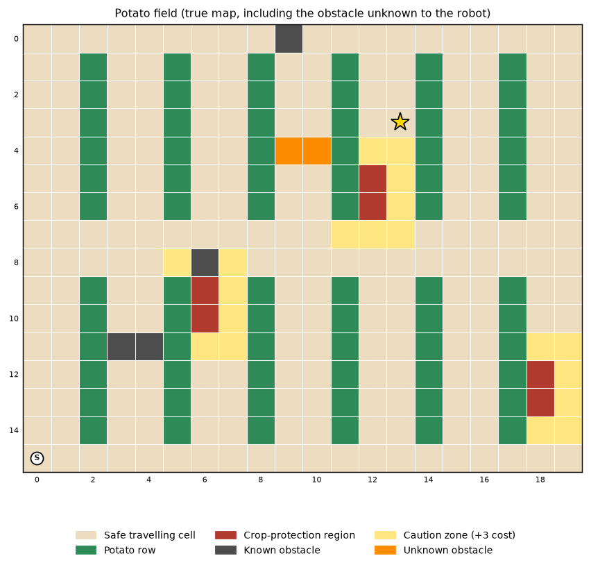
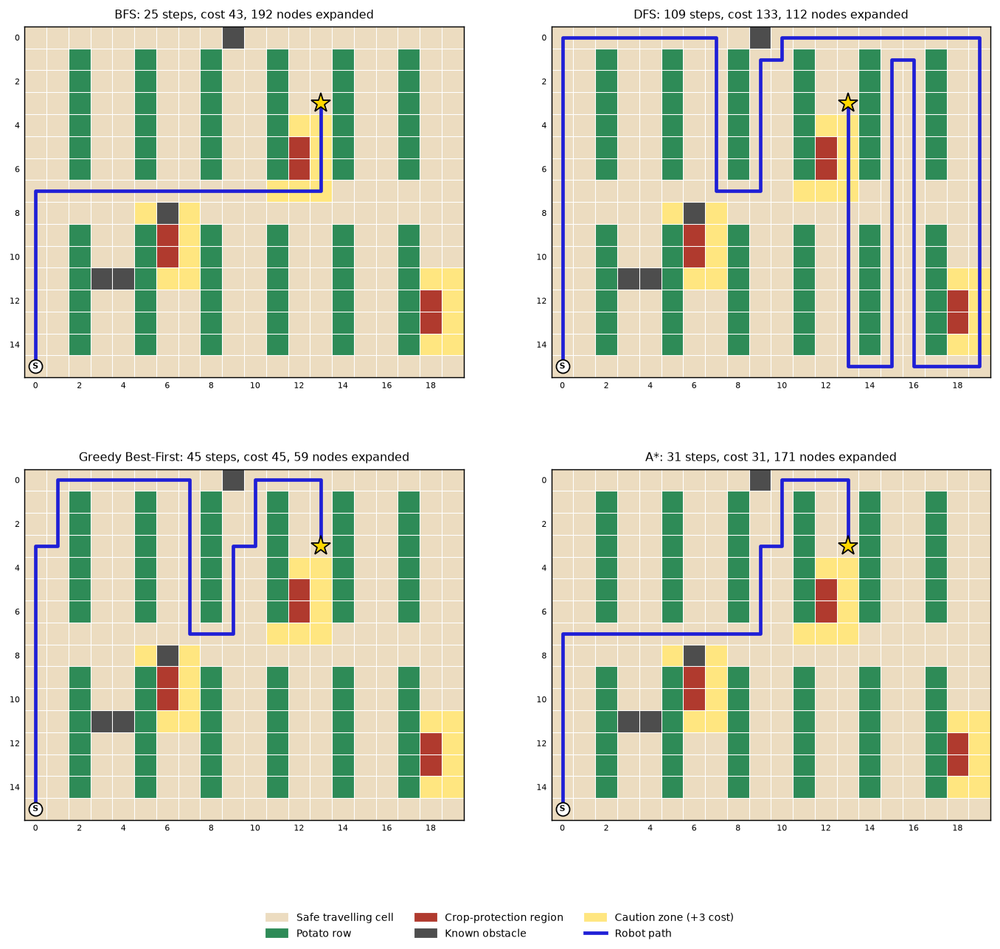
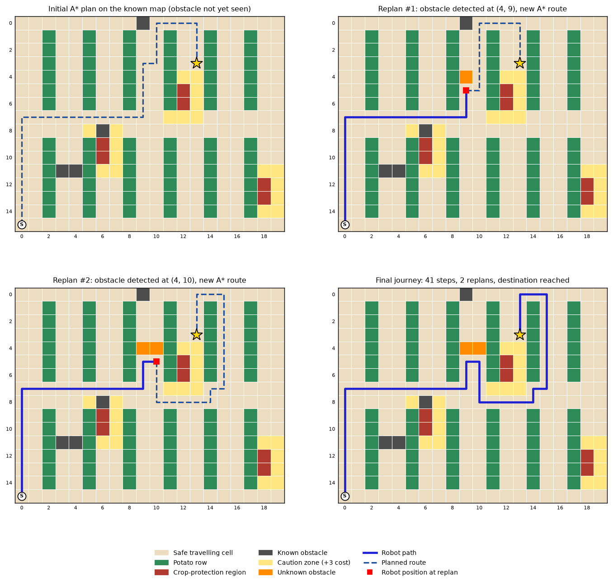

# Crop-Safe Path Planning for a Potato-Field Robot

Artificial Intelligence group coding assignment.

We model a potato field as a grid and plan a route for a monitoring robot from its start
cell to a destination. The robot is not allowed to drive over potato rows, protected crop
areas or obstacles, and we also want it to keep some distance from the protected areas when
it can. We implemented BFS, DFS, Greedy Best-First Search and A*, and compared them. In the
last part the field has an obstacle that the robot does not know about, so it has to detect
it on the way and replan.

## Group members

| Name | Roll number |
|---|---|
| Abdul Malik | BT24CSA046 |
| Ashwin Rathore | BT24CSA045 |
| Yash Khedekar | BT24CSA049 |
| Rajat | BT24CSA044 |
| Lakshya Rajdev | BT24CSA059 |

## Running it

You need Python 3 and Matplotlib.

```
pip install matplotlib
python cropsafe.py
```

This prints the field, the replanning log and the comparison table, and saves three figures
in `screenshots/`. Use `python cropsafe.py --show` if you also want the figures to open in a
window. All the code is in `cropsafe.py`.

## The field

The field is written as a text map at the top of `cropsafe.py`, so it is easy to change.
It is 16 rows by 20 columns. Potato rows run top to bottom with lanes two cells wide between
them. There is a cross alley in the middle and a free strip at the top and bottom.

```
.  safe cell                 P  potato row
X  crop-protection region    #  obstacle the robot knows about
?  obstacle the robot does not know about
S  start (15, 0)             G  destination (3, 13)
```



## Problem formulation

- State: the cell the robot is in, as (row, column).
- Initial state: the start cell S, which is (15, 0).
- Actions: move one cell up, right, down or left. We do not allow diagonal moves because a
  diagonal step between two crop cells would clip the plants.
- Transition model: the robot moves to the neighbouring cell in that direction. The move is
  only allowed if that cell is inside the field and is a safe cell.
- Goal test: the robot is in cell G, which is (3, 13).
- Path cost: each step costs 1. If the cell being entered touches a crop-protection region
  (including diagonally), the step costs 3 more.

## Algorithms

BFS uses a queue and expands the shallowest node first. It gives the path with the fewest
steps but does not look at step costs.

DFS uses a stack and goes as deep as it can before backing up. It returns the first path it
finds, which is usually long.

Greedy Best-First Search uses a priority queue ordered by h(n) only, so it always expands
the cell that looks closest to the goal.

A* uses a priority queue ordered by g(n) + h(n), where g(n) is the cost paid so far.

All four keep track of visited cells so no cell is expanded twice, and they try the
neighbours in the same order (up, right, down, left). Greedy and A* use the same function
in the code; the only difference is whether g(n) is added to the priority.

### Heuristic

We use the Manhattan distance, h(n) = |row - goal row| + |col - goal col|. Since the robot
moves in four directions and every step costs at least 1, the real cost to the goal can
never be less than this, so the heuristic is admissible. Moving one cell changes h by at
most 1, so it is also consistent. The penalty near protected crops only increases the real
cost, so it does not break this, and A* still returns the cheapest path.

## Crop-safe planning

There are two parts to this. First, potato rows, protection regions and obstacles are simply
never generated as neighbours, so none of the algorithms can enter them. Second, the free
cells around a protection region (yellow in the figures) cost 4 to enter instead of 1. A*
takes this cost into account, so it goes around the yellow cells when there is another way,
but it can still use them if there is not.

The effect is visible below. BFS takes the shortest way in and passes right beside the
protected block. A* goes round through the top of the field instead.



## Unknown obstacle and replanning

In the real field there is an obstacle at (4, 9) and (4, 10) that blocks one lane
completely. It is not on the robot's map. The robot first plans with A* on the map it has.
Then at every step it checks the four cells next to it (this is our simulated sensor). If it
sees an obstacle that is not on its map, it adds it. If that obstacle is on the route it was
going to take, it runs A* again from its current cell.

In our run the robot reaches (5, 9) and finds (4, 9) blocked. It replans to go around
through (4, 10), moves one cell, and finds that blocked too. The second replan takes it back
down to the alley and up the next lane. So there are 2 replans in total.



## Results

| Algorithm                    | Reached | Path length | Path cost | Expanded nodes | Time (ms) | Replans |
|------------------------------|---------|-------------|-----------|----------------|-----------|---------|
| BFS                          | Yes     | 25          | 43        | 192            | 0.237     | -       |
| DFS                          | Yes     | 109         | 133       | 112            | 0.169     | -       |
| Greedy Best-First            | Yes     | 45          | 45        | 59             | 0.140     | -       |
| A*                           | Yes     | 31          | 31        | 171            | 0.423     | -       |
| A* online (unknown obstacle) | Yes     | 41          | 41        | 266            | 0.774     | 2       |

Path length is the number of steps. The time for the first four rows is the average of 200
runs, and it changes a little from run to run and from machine to machine. For the online
row, the path length is what the robot actually travelled and the expanded nodes are added
up over all three A* calls.

### Observations

- BFS has the shortest path (25 steps), but 6 of those steps are next to the protected
  crops, so its cost is 43. It also expands the most nodes.
- DFS reaches the goal but its path is 109 steps and covers most of the field. Changing the
  order of the neighbours gives a completely different path.
- Greedy expands the fewest nodes (59) and is the fastest. Its path is 45 steps because it
  keeps heading straight for the goal and runs into crop rows. It did not touch the yellow
  cells here, but that is a coincidence since it never looks at the cost.
- A* has the lowest cost (31). It takes 6 more steps than BFS and stays away from the
  protected region completely. It expands about three times as many nodes as Greedy.
- With the unknown obstacle the robot still reaches the goal. It travels 41 steps instead of
  the 31 it planned at the start, because it only finds out the lane is blocked when it is
  already inside it.
